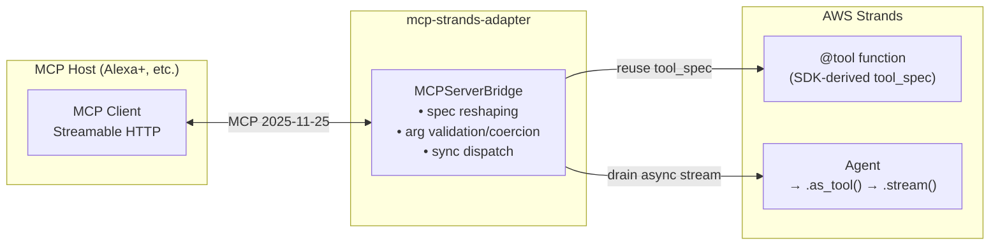

# mcp-strands-adapter

[](https://opensource.org/licenses/Apache-2.0)
[](https://www.python.org/downloads/)
[](https://modelcontextprotocol.io/)
[](https://strandsagents.com)

> **Expose AWS Strands Agents SDK tools and agents as Model Context Protocol (MCP 2025-11-25) tools over Streamable HTTP.**

---

## The gap this fills

The Strands Agents SDK ships tooling to **consume** MCP servers. It does not ship a
straightforward way to **expose** Strands agents and tools to an MCP host such as
Alexa+. This adapter covers that direction.

It also avoids redoing work the SDK already does well. Strands derives tool schemas
with Pydantic and `docstring-parser`, producing a `ToolSpec` whose JSON Schema is
nested at `inputSchema.json`. MCP expects that schema **flat** at `inputSchema`.
When you hand this bridge an object that is already a Strands tool, it reuses the
SDK's own `tool_spec` and performs only that reshaping.

---

## Install

```bash
pip install mcp-strands-adapter           # core (MCP only)
pip install "mcp-strands-adapter[strands]" # + AWS Strands Agents SDK
```

---

## Quickstart

### Serve Strands tools and agents to Alexa+

```python
from mcp.server.fastmcp import FastMCP
from strands import Agent, tool
from mcp_strands_adapter import MCPServerBridge

@tool
def tariff_shift(kwh: float, hours: int = 2) -> dict:
    """Shift load off the peak tariff window.

    Args:
        kwh: energy to shift
        hours: how long to defer
    """
    return {"shifted_kwh": kwh, "hours": hours}

mcp = FastMCP("household")
MCPServerBridge(prefix="hearth_").register_all(mcp, [tariff_shift])
# serve with: mcp.run(transport="streamable-http")
```

### Dispatch a `tools/call` payload

```python
bridge = MCPServerBridge(prefix="hearth_")
bridge.add(tariff_shift)

bridge.list_tools()                       # -> MCP tools/list definitions
bridge.call("hearth_tariff_shift", {"kwh": 3.0, "hours": 3})
```

### Export a whole Agent

```python
arbiter = Agent(
    name="hearth_arbiter",
    description="Resolves household conflicts.",
    system_prompt="You arbitrate conflicts.",
)
definition = bridge.add(arbiter)   # uses Agent.as_tool() internally
```

A bare `Agent` is adapted through the SDK's `Agent.as_tool()`. Because that result
exposes an async `stream()` rather than `__call__`, the bridge drives the stream on
a private event loop and returns the final text payload — MCP `tools/call` is
synchronous. An SDK-declared error is raised, not swallowed.

---

## What the bridge does for you

| Concern | Behaviour |
|---|---|
| Schema source | Reuses the SDK's `tool_spec` for Strands tools; reflects only plain callables |
| Schema reshaping | `inputSchema.json` (Strands) → flat `inputSchema` (MCP) |
| `int` vs `number` | Preserved exactly (`integer` is not widened to `number`) |
| Descriptions | Parsed from the docstring `Args:` block instead of `Parameter x` placeholders |
| Argument coercion | JSON scalars coerced to the annotated type (`"5"` → `5`) |
| Unknown arguments | Rejected with `TypeError` instead of silently dropped |
| Mounted defaults | Preserved, so the FastMCP schema matches the advertised definition |
| Agent streaming | `as_tool()` async `stream()` adapted to a synchronous MCP call |

---

## Architecture



---

## Testing

```bash
pip install -e ".[dev]"
pytest tests/ -v
```

Strands-specific tests skip automatically when the optional extra is absent, so the
suite is green with or without it.

---

## License

Licensed under the [Apache License, Version 2.0](LICENSE).